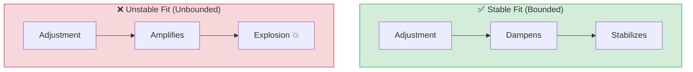
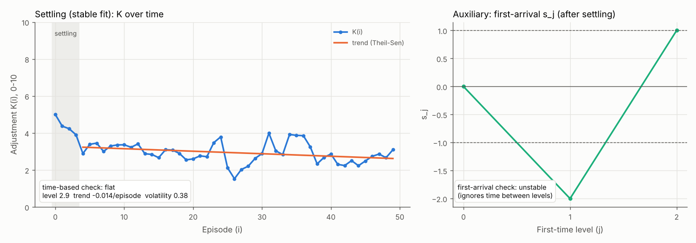
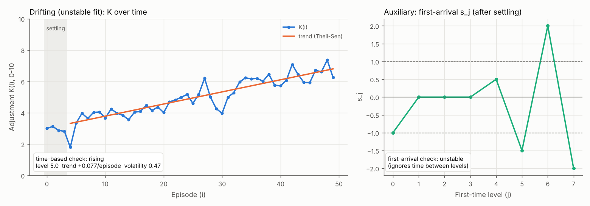
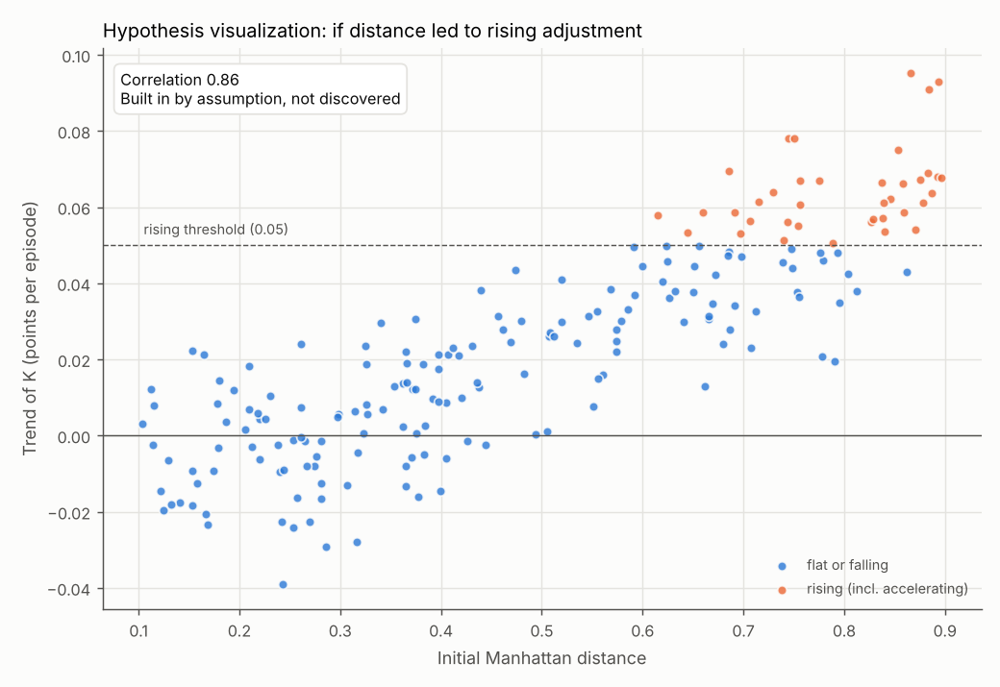

# Theory: Fit as Dynamic Stability

> **Note:** The core mathematical model in this document was proposed by community member [@mwdelaney1325-cmd](https://github.com/mwdelaney1325-cmd) in [Discussion #7](https://github.com/DevAaronJeong/continuum-protocol/discussions/7).

> **Correction (November 2026):** The first Phase 0 simulation had two problems, both found by [@mwdelaney1325-cmd](https://github.com/mwdelaney1325-cmd) in [Issue #4](https://github.com/DevAaronJeong/continuum-protocol/issues/4#issuecomment-7043217541): its "stable" trajectories still drifted upward over long runs, and its stability check read levels in the order they first appeared instead of over time. The simulation, the stability check, and Figures 1–3 were revised. See [Correction (November 2026)](#correction-november-2026).

---

## The Core Insight

Traditional approaches to "fit" treat it as a **static property**: a snapshot comparison at time $t=0$.

This document proposes an alternative: **fit as dynamic stability** — a question of whether alignment remains feasible under iteration.

---

## Two Different Questions

| Approach | Question | What It Measures |
|----------|----------|------------------|
| **Static Distance** (current) | "Are we aligned right now?" | Manhattan Distance at $t=0$ |
| **Dynamic Stability** (proposed) | "Will this alignment stay feasible over time?" | Temporal behavior of adjustment demands |

**Both are necessary.** The first tells us where to start; the second tells us whether we can stay there.

---

## Mathematical Formulation

*The following model is from [@mwdelaney1325-cmd](https://github.com/mwdelaney1325-cmd)'s [original comment](https://github.com/DevAaronJeong/continuum-protocol/discussions/7#discussioncomment-11846588).*

### Setup

Let $i \in \mathbb{N}$ index work episodes (days, meetings, tasks — pick a consistent unit).

Define:
- $K(i) \in \mathbb{Q}$ = deterministic scalar "work-state readout"
- $L(i) := \lfloor K(i) \rfloor \in \mathbb{Z}_{\geq 0}$ = integer-grain readout

Form the sequence of **first-time-seen readout levels** (new states encountered as experience accumulates):
$$a_1 < a_2 < a_3 < \cdots$$

Define:
- $\Delta_j := a_{j+1} - a_j$ = step size between new states
- $s_j := \Delta_{j+1} - \Delta_j$ = **change in step size** (acceleration of adjustment demands)

### Stability Criterion

**Good Fit (Stable System):**
$$\exists C < \infty \text{ such that } |s_j| \le C \text{ (after an initial settling period)}$$

Adjustment pressure does not amplify. Disturbances dampen out.

**Bad Fit (Unstable System):**
$$|s_j| \text{ grows with } j$$

Adjustment demands compound. Disturbances propagate and amplify.

### Visual Comparison



### Reading Stability From a Finite Record

The criterion above is about the whole sequence, however long it runs. Any real record is finite, so two limits apply:

1. **No finite window proves boundedness.** Whatever bound a record seems to respect, a longer record could exceed it. A record can only show how $K$ behaved while it was observed.
2. **First-arrival gaps alone cannot tell bounded from rising.** The levels $a_j$ are recorded when they first appear, and the time between them is dropped. With a quantize step of 0.5:

| $K$ over time | First-arrival $s_j$ | First-arrival reading | What actually happens |
|---|---|---|---|
| 0, 2, 1 | −3 | unstable | adjustment stays between 0 and 2 |
| 0, 1, 2, 3, 4 | 0, 0, 0 | stable | adjustment rises every episode |

(The formulation writes $a_1 < a_2 < \cdots$, but new levels only arrive in that order while $K$ keeps reaching new highs.)

So the stability check reads $K$ against time, after a settling period:

| Quantity | What it is | Question it answers |
|---|---|---|
| **Level** | Median of $K$ | How much adjustment, typically? |
| **Trend** | Theil–Sen slope of $K$ per episode (the median of all pairwise slopes, so one bad week can't drag it far) | Is adjustment rising, flat, or easing? |
| **Volatility** | Typical distance from the trend line | How much does it swing from episode to episode? |
| **Trend change** | Slope in the later half minus slope in the earlier half | Is the rise speeding up? |

A trend within ±0.05 points per episode (one point on a 0–10 scale over 20 episodes) reads as *flat*. Above that it reads as *rising*, or *accelerating* if the later half rises faster by more than 0.05. These cutoffs are starting values chosen on synthetic data, to be revisited with real diary data.

Every label describes the observed window only. "Flat" means no clear trend so far, not "bounded forever."

First-arrival gaps stay in the code as an auxiliary description of how new levels arrive.

---

## Visualizing the Theory (Phase 0 Simulation)

To check that the measurements behave as intended, we generated synthetic trajectories on the 0–10 scale planned for the diary study: one that settles to a fixed baseline, and one whose baseline keeps rising. They illustrate the model's assumptions; they are not evidence about people (see [Philosophical Constraints](#philosophical-constraints-the-trap-of-solving-people)).

### Correction (November 2026)

The first version of this section had two problems, both found by [@mwdelaney1325-cmd](https://github.com/mwdelaney1325-cmd) in [Issue #4](https://github.com/DevAaronJeong/continuum-protocol/issues/4#issuecomment-7043217541):

1. **The "stable" generator drifted.** It used $K_i = (1 - 0.2s)\,K_{i-1} + 0.03(1-s)\,i + \text{noise}$. For any $0 < s < 1$ this grows like $\frac{0.15(1-s)}{s}\,i$: at $s = 0.8$ with the noise off, $K$ reaches 1.64 by episode 50 and 18.52 by episode 500. The "stable" case was slow drift, not a return to a fixed level. Over the 50 episodes plotted, the drift was small enough to look bounded.
2. **The check ignored time.** It read stability from first-arrival gaps alone, which fails in both directions (see [Reading Stability From a Finite Record](#reading-stability-from-a-finite-record)).

What changed:
- The stable case now returns to a fixed baseline (mean reversion). With the noise off, it ends at its baseline however long it runs. The unstable cases are a baseline that keeps rising (persistent drift) and one that rises faster and faster.
- The stability check reads level, trend, and volatility over time. First-arrival gaps are kept as an auxiliary measure.
- His two examples are unit tests.
- Figures 1–3 were regenerated. The originals are in the Git history.

### 1. Stable Fit (Settling)

$K(i)$ starts high, as in a new job, then returns to a fixed baseline. It keeps fluctuating, but the fluctuations don't build into a trend.

**Readings (this run):**
- Level 2.9, trend −0.014 per episode, volatility 0.38
- Time-based check: **flat**
- First-arrival check: unstable (noise produces new levels out of order)
- **Meaning:** "About the same effort now as a few months ago"



---

### 2. Unstable Fit (Drifting)

The baseline rises by 0.08 per episode, so adjustment climbs steadily: about 4 points over 50 episodes.

**Readings (this run):**
- Level 5.0, trend +0.077 per episode (the true rate is 0.08), volatility 0.47
- Time-based check: **rising**
- First-arrival check: unstable, the same reading it gave the settling case
- **Meaning:** "Need more effort each week to stay functional"



---

### 3. How Many Episodes Does the Check Need?

Share of synthetic trajectories the time-based check calls *rising* (including *accelerating*), by the number of episodes after a 4-episode settling period. 500 trajectories per cell; noise of 0.5 points per episode.

| Kind | 8 episodes | 12 | 26 | 50 |
|---|---:|---:|---:|---:|
| Settling | 29% | 19% | 2% | 0% |
| Noisy but flat (noise 1.2) | 40% | 34% | 23% | 3% |
| Drifting (+0.08 per episode) | 56% | 64% | 85% | 100% |
| Accelerating | 38% | 39% | 62% | 100% |

- **With 50 episodes, the check separates the kinds.** Settling and noisy-but-flat trajectories are rarely called rising; drifting and accelerating ones always are. Telling *accelerating* from plain *rising* is harder: 83% of accelerating trajectories are called accelerating, and so are 12% of drifting ones.
- **With 8–12 episodes, it can't.** About a fifth to a third of settling trajectories are called rising, and only half to two-thirds of drifting ones are.
- **The first-arrival check doesn't separate them at any length.** It calls 65–100% of every kind unstable.
- **These rates depend on the noise level**, which is made up here. How noisy real weekly answers are is unknown; measuring that is the first job of the diary pilot (Roadmap Experiment 2.6).

---

### 4. Hypothesis Check

This visualization shows what we **expect** to find in real data if the assumption (larger initial distance → rising adjustment) holds. Each synthetic pair gets a drift that grows with its distance beyond 0.3, and the time-based check reads the result.

**⚠️ Important:** The correlation shown here is built into the simulation as an assumption. Real validation requires actual human data where the relationship is discovered, not assumed.

It also shows a limit of the cutoff: pairs that drift slowly (below 0.05 per episode) read as flat.



---

### Run the Simulation Yourself

```bash
# Basic demo
python examples/stability_simulation.py

# Run unit tests
python examples/stability_simulation.py --test

# Regenerate Figures 1-3 in docs/assets/
python examples/stability_simulation.py --save-figures
```

**What you'll see:**
- Settling, drifting, and accelerating trajectories, read by both checks
- The Issue #4 examples
- The episode-count table above
- Quantize sensitivity (auxiliary measure only)
- Hypothesis visualization (with warnings)

---

## Redefining Burnout

In this model, **burnout** is not:
- ❌ High effort
- ❌ Long hours
- ❌ Acute stress

Burnout is:
- ✅ **Unbounded acceleration in self-correction**

It's not "working hard" — it's "working harder every week just to stay in place."

This matches the subjective phenomenology of burnout more accurately than static stress metrics.

---

## Relationship to Manhattan Distance

Our current alignment model uses **Manhattan Distance**:
$$\text{alignment} = 1 - \sum_{i} \alpha_i \cdot |h_i - w_i|$$

This measures **initial friction** at $t=0$:
> "Are we walking at the same speed right now?"

The stability model asks a different question:
> "Do I need to run faster each day just to keep up?"

### Complementary, Not Competitive

These metrics serve different purposes:

| Metric | Measures | When to Use |
|--------|----------|-------------|
| **Manhattan Distance** | Initial alignment | Screening, first-pass matching |
| **Stability (trend of $K$ over time)** | Long-term sustainability | Predicting burnout risk, retention |

**Hypothesis:** Large Manhattan Distance may correlate with rising $K$, but this is empirically testable.

---

## What This Means for the Project

### Before (Static Model)

Goal: "Find people and work with minimal distance"

Problem: A small distance at $t=0$ doesn't guarantee long-term sustainability.

### After (Dynamic Model)

Goal: "Find people and work where adjustment demands stay bounded"

Benefit: Directly targets sustainability, not just initial fit.

---

## How to Measure This

### Proposed Experiment

**Track over time (months, not weeks; see [How Many Episodes Does the Check Need?](#3-how-many-episodes-does-the-check-need)):**

1. **Weekly question:** "How much did you have to adjust this week to stay functional?"
   - Scale: 0 (no adjustment) to 10 (constant correction)

2. **Plot the sequence:** $K(1), K(2), \ldots$

3. **Skip a settling period** (the first few weeks)

4. **Read level, trend, and volatility** of $K$ over the remaining weeks

5. **Describe the window:**
   - Flat → no sign of rising adjustment so far
   - Rising → adjustment is climbing (burnout risk)
   - Accelerating → it is climbing faster over time

6. **Auxiliary:** first-time readout levels $a_j$ and $s_j = \Delta_{j+1} - \Delta_j$, as a description of how new levels arrive

### Success Criteria

- **Predictive validity:** Does Manhattan Distance at $t=0$ predict the trend of $K$?
- **Phenomenological match:** Do people whose $K$ rises report burnout?
- **Actionable:** Can we intervene when $K$ starts rising?

---

## Open Questions

1. **What's the "settling period"?**
   - How long before $K$ settles enough to read a trend?
   - Does it vary by person, domain, or work type?

2. **Can we predict the trend of $K$ from static features?**
   - Does large Manhattan Distance → rising $K$?
   - Or does small persistent distance → rising $K$?

3. **How do we operationalize "work-state readout" $K(i)$?**
   - Self-reported adjustment effort?
   - Behavioral metrics (e.g., calendar changes)?
   - Physiological markers (e.g., HRV)?

4. **Does this generalize across domains?**
   - Tech vs. healthcare vs. education
   - Different cultures, work structures

5. **How noisy are real weekly answers?**
   - The episode-count table assumes 0.5 points of noise per week
   - Noisier answers need longer records before a trend can be read

6. **What does a 0–10 scale hide?**
   - Someone already near 10 can't report rising adjustment (a ceiling)
   - People use scales differently; reading each person's own trend avoids some of this, but not the ceiling

---

## Why This Matters

This model shifts the project from:
- ❌ "Finding the perfect match" (static optimization)

To:
- ✅ "Finding a stable system" (dynamic stability)

Where small mismatches dampen out instead of exploding.

---

## Related Reading

- **Original Discussion:** [Discussion #7](https://github.com/DevAaronJeong/continuum-protocol/discussions/7)
- **Static Distance Model:** [Technical Philosophy - Manhattan Distance](technical-philosophy.md#3-manhattan-distance--similar-speed-our-choice)
- **Open Questions:** [Is "fit" a property or a dynamic?](open-questions.md#is-fit-a-property-or-a-dynamic)

---

## Acknowledgments

This framework was proposed by [@mwdelaney1325-cmd](https://github.com/mwdelaney1325-cmd) in [Discussion #7](https://github.com/DevAaronJeong/continuum-protocol/discussions/7).

The core insight — that fit is about whether disturbances dampen out or propagate — fundamentally reframes the project's goals.

---

## Philosophical Constraints: The Trap of "Solving" People

*Based on community discussion regarding the nature of this model.*

### 1. Assumptions vs. Hypotheses

This project does not follow the traditional scientific method (`Hypothesis → Test → Solve`) because human behavior is not a closed domain to be "solved."

- **Hypotheses** seek a solution/outcome.
- **Assumptions** act as alignment constraints.

Phase 0 Simulation is **not** trying to prove a hypothesis (e.g., "prove Manhattan distance causes instability"). It is **visualizing an assumption** (e.g., "assuming Manhattan distance represents friction, what does instability look like?"). We refine the model not by solving it harder, but by keeping our assumptions disciplined.

### 2. The Role of Time

Time ($t$) must remain an **external lens**, not an internal formation variable.

- **Wrong:** Injecting time into the vector formation loop (trying to predict how vectors change).
- **Right:** Using time to observe the stability of the output (as the stability check does, reading $K$ against the episode index).

If we import time too early, the model will drift undetectably.

### 3. Drift is Not an Error

When the model drifts (alignment degrades), we should not add more axioms or complex geometry to "fix" it. Drift points are moments to re-articulate descriptions. They reveal **Prime Events**—events that add no new data but are necessary to prevent system collapse.

---

## Status

**Current:** Theoretical model, not yet empirically tested.

**Next steps:**

### Phase 0: Synthetic Simulation
Before involving real people, validate the model computationally:

1. **Generate synthetic trajectories:**
   - Simulate stable fit: mean reversion around a fixed baseline
   - Simulate unstable fit: a baseline that keeps rising (persistent drift), or rises faster and faster

2. **Visualize $K$ over time:**
   - Read level, trend, and volatility, with first-arrival $s_j$ alongside
   - Identify visual signatures of stability vs. instability

3. **Check consistency between Static Distance assumptions and Dynamic Stability observations:**
   - Does initial distance relate to $s_j$ trajectory patterns?
   - Generate 100s of synthetic person-work pairs
   - Observe if the assumption of friction holds in simulation

**Why this matters:** Synthetic data lets us debug measurement protocols and refine assumptions before involving humans.

- **Outcomes:**
  - ✅ Visualized signatures of stable vs. unstable trajectories ([See Graphs](#visualizing-the-theory-phase-0-simulation)), revised November 2026 ([Correction](#correction-november-2026))
  - ~~Observed consistency between Manhattan Distance assumptions and $s_j$ behavior~~ **Withdrawn (November 2026).** The simulation sets stability from distance by assumption, so any agreement between them is the assumption showing through, not an observation. Only real data can show it (Phase 3).
  - ✅ Established sensitivity range for quantize parameter (0.5 - 1.0), for the auxiliary first-arrival measure only
  - ✅ Time-based stability check (level, trend, volatility), with the Issue #4 examples as unit tests and an estimate of how many episodes it needs (Roadmap Experiment 2.4)

👉 **Code:** `examples/stability_simulation.py`

---

### Phase 1: Design Measurement Protocol
Define how to measure $s_j$ with real people:

- Weekly question: "How much did you adjust this week?" (0-10 scale)
- Alternative metrics: Calendar changes, communication pattern shifts, self-reported friction
- Read level, trend, and volatility of $K$ over time (done on synthetic data in Experiment 2.4), with "first-time-seen states" ($a_j$) as an auxiliary measure

---

### Phase 2: Pilot Study
Small-scale observation with consenting participants:

- 10-20 people, 12 weeks
- Track $K(i)$ weekly
- Compute level, trend, and volatility of $K$ and observe stability patterns
- 12 weeks is enough to measure how noisy the answers are and how many people keep answering, but at the synthetic noise level it is too short to sort people by trend
- Compare with qualitative burnout reports

---

### Phase 3: Observe Consistency
Observe whether Manhattan Distance assumptions align with $s_j$ patterns:

- Compare initial alignment scores with the trend of $K$
- Observe if the assumption holds: large distance → rising $K$

---

*Last updated: November 2026*
