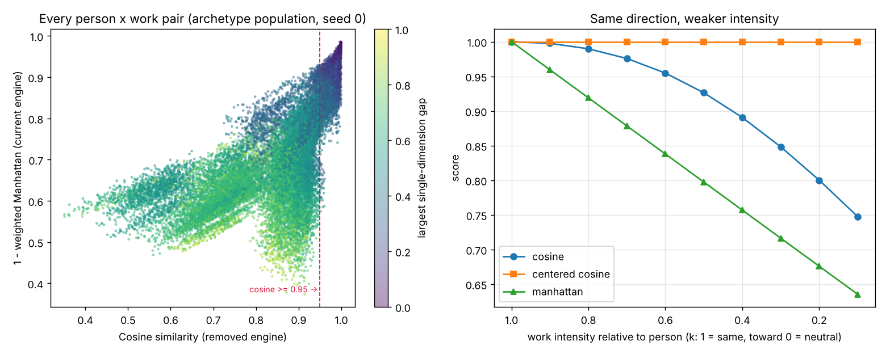

# Metric Analysis: What Removing Cosine Actually Changed

> Follow-up to [Issue #4](https://github.com/DevAaronJeong/continuum-protocol/issues/4): *"Why we chose Manhattan Distance over Cosine."*
>
> Reproduce everything below with:
> ```bash
> python examples/metric_comparison.py          # full report
> python examples/metric_comparison.py --plot   # also writes docs/assets/metric_comparison.png
> python examples/metric_comparison.py --test   # unit tests
> ```

⚠️ **Synthetic data only.** This analysis can show *where* Cosine and Manhattan disagree and *what kind* of matches they disagree on. It cannot show which one matches how fit feels to a real person. Every number here is disagreement, not accuracy.

---

## TL;DR

1. **The switch is not cosmetic.** Cosine and Manhattan pick a different #1 match for roughly half of people (top-1 agreement 39–55% depending on population).
2. **The disagreement is the kind Issue #4 predicted.** Matches that only Cosine likes are mostly *"same shape, different overall level"*: 53–67% of their gap is a uniform shift in intensity, versus 29–38% for matches only Manhattan likes.
3. **The worked example in Issue #4 mixes two problems.** Plain Cosine on 0–1 scales measures angles from zero, so almost every profile "points the same way" (median score 0.79–0.93). Measuring from the scale midpoint (centered Cosine) fixes the Job A / Job B example on its own.
4. **The decision still holds against that stronger Cosine.** Centered Cosine stays at a perfect 1.000 while a job's intensity drops to a fraction of the person's. It sees direction, never speed.
5. **Within distance metrics, the choice matters much less.** Euclidean and Manhattan agree closely (rank correlation 0.94–0.98). The real fork was Cosine vs. distance.
6. **Manhattan has weak spots of its own**: it cannot tell one dealbreaker from spread-out friction, the energy dimension's weight is weaker than it looks, and it treats overload and boredom as equal.

---

## Setup

| | |
|---|---|
| **Vectors** | The 5 engine dimensions: energy rhythm (engine's own encoding: morning 0, afternoon 0.33, evening 0.66, distributed 0.5), flexibility, interaction, change tolerance, intensity |
| **Weights** | Engine defaults (0.25 / 0.15 / 0.20 / 0.20 / 0.20), applied to every metric |
| **Metrics** | Cosine (what `src/prototype.py` used), centered Cosine (measured from 0.5), weighted Manhattan (current engine), weighted Euclidean, Chebyshev (largest single gap) |
| **Populations** | *Archetype*: `examples/synthetic_data.py` archetypes. *Uniform*: every value uniform in [0, 1], no structure |
| **Size** | 500 people × 50 work profiles, 5 seeds each |
| **Robustness** | Every population run twice: with all 5 dimensions, and with the 4 continuous ones only (energy rhythm dropped) |
| **Sanity check** | The real engine's score ranks work almost identically to plain weighted Manhattan on these vectors (median per-person rank correlation 0.98–0.99), so the comparison is fair to the engine |

---

## 1. The worked example, re-checked

Person: morning = 0.9, solo = 0.2.

| Job | Vector | Cosine | Centered Cosine | Manhattan distance |
|-----|--------|-------:|----------------:|-------------------:|
| A | [0.3, 0.1] | 0.995 | 0.179 | 0.70 |
| B | [0.85, 0.25] | 0.998 | 1.000 | 0.10 |
| C | [0.1, 0.9] | 0.323 | −0.990 | 1.50 |

The doc's claim holds: plain Cosine rates A (0.995) almost the same as B (0.998).

But the explanation in Issue #4, *"Same pattern! Both prefer mornings over evenings!"*, is not quite what happens. On a 0–1 scale, **0.3 is below the midpoint**: Job A leans *evening*. Plain Cosine can't see that, because it measures angles from 0 and every profile lives in the same positive corner. Once you measure from the midpoint (centered Cosine), A drops to 0.18 and the example no longer separates the two metrics.

So the example shows a **scale artifact**, not yet magnitude blindness. The magnitude problem is real, but it needs a different example.

---

## 2. The real blind spot: intensity

Take one person (morning, flexible 0.9, solo 0.1, routine 0.2, intense 0.9) and pull a work profile toward neutral by a factor *k*: same direction on every dimension, weaker intensity.

| k | Cosine | Centered Cosine | Manhattan | Largest gap |
|---:|---:|---:|---:|---:|
| 1.00 | 1.000 | 1.000 | 1.000 | 0.00 |
| 0.75 | 0.984 | 1.000 | 0.899 | 0.12 |
| 0.50 | 0.926 | 1.000 | 0.797 | 0.25 |
| 0.25 | 0.825 | 1.000 | 0.696 | 0.38 |
| 0.10 | 0.748 | 1.000 | 0.635 | 0.45 |

- **Centered Cosine never moves.** "Leans the same way" is all it can see. This is the *Words vs. Speed* argument in its cleanest form.
- **Manhattan falls steadily** with the intensity gap.
- **Plain Cosine drops here only because this profile is lopsided.** For someone who is high on everything (all 0.9), a job at all 0.6 scores a perfect **1.000** on plain Cosine and 0.700 on Manhattan. Its sensitivity depends on the profile's shape, not on the gap.



*Left: every person × work pair in one archetype run. The tall band just left of the red line is where Cosine says "near-identical" and Manhattan says "weak." Right: the table above as curves.*

---

## 3. Population study

Mean over 5 seeds. Each row compares a metric's ranking of the 50 work profiles to Manhattan's, per person.

**Archetype population, 5 dimensions**

| vs. Manhattan | Rank correlation | Same #1 match | Top-5 overlap |
|---|---:|---:|---:|
| Cosine | 0.70 | 41% | 59% |
| Centered Cosine | 0.92 | 67% | 79% |
| Euclidean | 0.97 | 76% | 84% |
| Chebyshev | 0.86 | 44% | 64% |

**Across all four runs** (archetype / uniform × 5 dims / 4 dims):

| vs. Manhattan | Rank correlation | Same #1 match |
|---|---:|---:|
| Cosine | 0.59–0.86 | 39–55% |
| Centered Cosine | 0.84–0.92 | 55–67% |
| Euclidean | 0.94–0.98 | 75–79% |
| Chebyshev | 0.67–0.86 | 44–58% |

**Score compression.** Plain Cosine's median score is 0.79–0.93 (Manhattan: 0.67–0.72). In the archetype population, Cosine calls **24%** of all pairs "near-identical" (≥ 0.95), and 35% when energy rhythm is dropped. In the 4-dimension run, about a quarter of those "near-identical" pairs still have a gap of 0.4 or more on some dimension.

**What this means:**
- Removing Cosine changes the top recommendation for roughly every second person. It is a real design decision, not a refactor.
- A good part of plain Cosine's disagreement is the zero-origin artifact: centered Cosine is closer to Manhattan on the #1 match in every run, and on rank correlation in three of four.
- Euclidean vs. Manhattan is a much smaller choice. It still changes the #1 match for about 1 in 4 people, because Euclidean penalizes one concentrated gap more than several small ones (see §5a).

---

## 4. What kind of matches change

Split any person–work gap into two parts:
- **Level shift**: the work is uniformly louder or quieter than the person.
- **Shape difference**: everything left over.

Then look at the matches each metric puts in a person's top 5 that the other doesn't.

| Matches in top 5 of... | Share of gap that is a level shift |
|---|---:|
| Cosine only | 0.53–0.67 |
| Manhattan only | 0.29–0.38 |
| All pairs (baseline) | 0.31–0.51 |

Cosine's distinctive picks are jobs with **the right shape at the wrong intensity**, exactly the case Issue #4 describes ("they say they're a morning company, but 9 AM meetings feel late to me"). Synthetic data confirms the disagreement is concentrated there. Whether people *experience* those matches as worse is the open question.

---

## 5. Where Manhattan is weak

Issue #4 asked for criticism. Three findings:

### (a) It cannot tell a dealbreaker from spread-out friction

| Gap pattern (5 dims) | Manhattan | Euclidean | Chebyshev |
|---|---:|---:|---:|
| one gap of 0.60 | 0.880 | 0.732 | 0.400 |
| five gaps of 0.12 | 0.880 | 0.880 | 0.880 |

How often does this bite? The share of people whose Manhattan #1 match hides a single gap ≥ 0.5 is **0–7%** depending on the population (highest in the uniform one). For **up to 3.3%** of people, an alternative within 0.02 of the top score had no such gap. Small, but not zero, and invisible in the score.

### (b) The weights don't mean what they look like

| Dimension | Weight | Max distance | Max penalty |
|---|---:|---:|---:|
| energy | **0.25** | 0.66 | **0.165** |
| flexibility | 0.15 | 1.00 | 0.150 |
| interaction | 0.20 | 1.00 | 0.200 |
| change | 0.20 | 1.00 | 0.200 |
| intensity | 0.20 | 1.00 | 0.200 |

Energy rhythm has the largest weight, but because its codes only span 0–0.66, the worst rhythm mismatch costs less than the worst interaction, change, or intensity mismatch. (The engine's docstring also calls the rhythm space "circular," but the code treats it as a line.)

### (c) It is symmetric

A job 0.3 *more* intense than you and one 0.3 *less* intense score the same. The engine's explanations already distinguish the two ("more intense than you prefer" vs. "too slow-paced"), but the score does not. Overload and boredom may not cost the same.

---

## 6. What this analysis does *not* show

- **Which metric is right.** Synthetic profiles have no feelings. Any "regret" measured against Manhattan assumes Manhattan is the truth.
- **That the dimensions are the right ones.** All metrics share the same five dimensions and weights.
- **Anything about change over time.** This is the t = 0 snapshot. See [fit-as-stability.md](fit-as-stability.md) for the dynamic view.

---

## 7. Suggested next steps

1. **A targeted human test.** Instead of A/B testing metrics on random matches, show people only the pairs where the metrics disagree most: same direction, different intensity (§4). This is the cheapest test that can actually separate the hypotheses, and it fits Roadmap Experiment 2.2 and the "A/B test different metrics" idea in [open-questions.md](open-questions.md).
2. **Make the argument against the strongest Cosine.** In the docs, compare Manhattan with *centered* Cosine (§2) rather than plain Cosine. The case is cleaner and harder to dismiss.
3. **Surface dealbreakers without changing the score.** Add a line to the explanation whenever any single dimension differs by 0.5 or more. This keeps Manhattan's interpretability and covers §5(a).
4. **Normalize the energy distance to [0, 1]** or document effective weights, so the weights mean what they say (§5b).

---

## Housekeeping found along the way

- **`src/prototype.py`, the original Cosine engine, has since been removed.** Its own demo (Alice vs. startup / async) ranked the two roles the same way under both metrics, so it could never have shown the difference. Its cosine logic lives on as the `cosine` metric in `examples/metric_comparison.py`.
- **Fixed in this change:** `examples/synthetic_data.py` chose the `routine_specialist` energy rhythm once at import time, so every routine specialist in a run shared one rhythm and seeded runs weren't reproducible. Rhythms are now sampled per profile.

---

*Analysis script: [`examples/metric_comparison.py`](../examples/metric_comparison.py). All numbers above come from its default run (seeds 0–4).*
